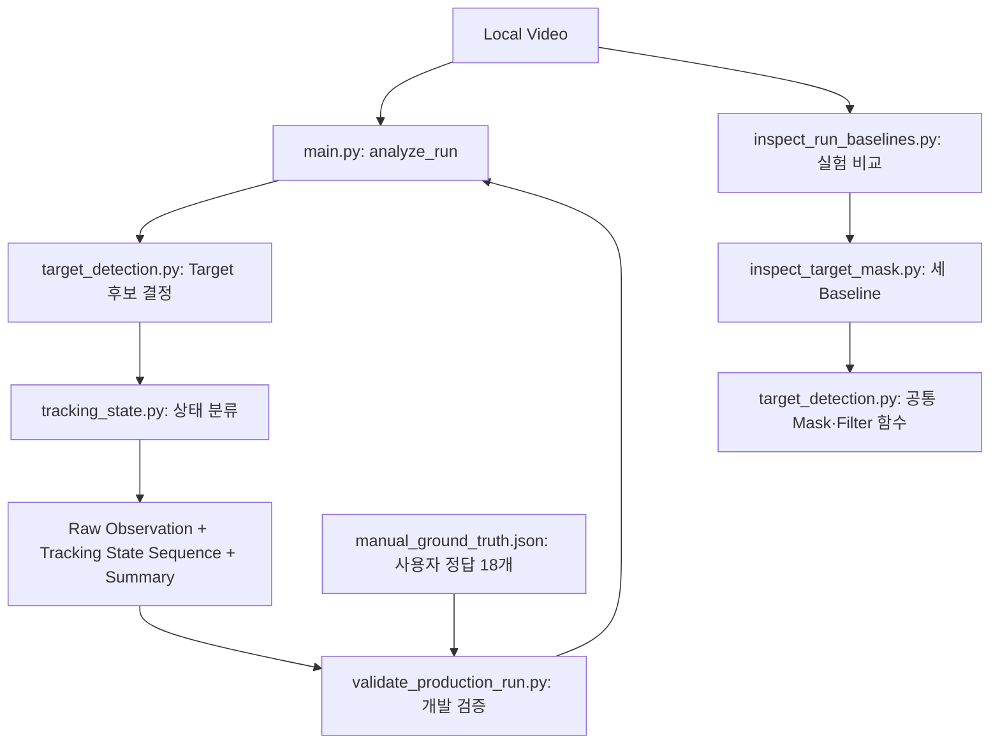

# Vision-based Aim Tracking Analyzer

에임 트레이너 녹화 영상에서 Target 위치와 조준 상태 변화를 기록하는 개인 포트폴리오 프로젝트입니다. Python·OpenCV 기반 로컬 분석 코어를 구현했으며, **2026-10-13 Phase 2 — Target Detection & Trajectory를 완료했습니다.** 다음 단계는 Phase 3 — Tracking Metrics입니다.

## Problem — 해결하려는 문제

게임 점수만으로는 언제 조준이 Target을 벗어났는지 알기 어렵습니다. 실제 Run의 60초 구간을 Frame 단위로 처리하여 Target 중심 좌표와 `ON_TARGET / OFF_TARGET / MISSING` 상태를 기록합니다.

## Solution — 현재 구현 범위

현재 MVP 영상의 밝은 청록색 Target을 HSV로 분리하고, **5×5 Closing + Top-strip Filter**로 후보를 정리합니다. 후보가 정확히 하나일 때만 Target을 결정합니다. 화면 중앙 Crosshair가 선택된 Contour 안에 있는지 확인하고, 전체 Run의 관찰값과 상태 목록을 반환합니다.

영상 입력 검증, 순차 디코딩, Run 구간 처리, Target 위치 기록, 상태 분류 및 검증 도구까지 구현했습니다. Phase 3에서는 연속 OFF_TARGET 관측 구간의 묶기·지속 시간과 기초 Run Metric을 구현하고 Synthetic Sequence로 검증했습니다. 실제 3600 Frame과의 정합성 확인은 다음 작업입니다. Recovery·방향별 Metric·Score와 Web/API는 후속 범위입니다.

## My Role — 직접 구현과 AI 지원

- 직접 구현: 영상 입력 검증, 순차 디코딩, Frame 시간·Run 구간 처리, HSV·Contour·Bounding Box·Center 흐름, 상태 분류와 집계, 최초 ON_TARGET 경계.
- 직접 검증·결정: 원본 Frame의 수동 Ground Truth 18개, Baseline 집계 연결, 최종 Closing+Top-strip 정책 선택과 환경 제약 승인.
- Phase 3 직접 구현: MISSING 경계 계약과 `off_target_interval` 명명, 구간 묶기·Duration·Run Metric 계산, 작은 입력과 테스트 실행.
- AI 지원: 개념 설명과 코드 Review, 공통 로직 재사용, 반복 비교·변경 기록·표본 선정·보고서·추가 테스트, 승인 후 Production 반영·정리·문서화.

학습한 코드를 설명하고 검증하는 것을 목표로 하는 AI-assisted development 프로젝트입니다.

## Tech Stack — 검증 환경

| 기술 | 실행 확인 버전 | 역할 |
| --- | --- | --- |
| Python | 3.12.0 | 함수, 목록·Dictionary, 파일·오류 처리 |
| OpenCV | 5.0.0 (`opencv-python` 5.0.0.93) | 영상 디코딩, HSV, Closing, Contour, Point-in-Contour |
| NumPy | 2.5.3 | 이미지 배열과 uint8 Kernel |
| pytest | 9.1.1 | 검출·상태·비교·검증 함수 테스트 |
| pathlib / json / hashlib | Python 표준 라이브러리 | 경로, 검증 자료 저장, 입력 영상 동일성 확인 |

## Architecture — 파일별 책임



| 파일 | 책임 |
| --- | --- |
| `src/main.py` | 입력 검증, 순차 Decode, Run 선택, 관찰값·상태·Summary 반환. CLI에서는 요약 출력 |
| `src/target_detection.py` | 승인된 하나의 Detection 정책, Bounding Box·Center·Contour 반환 |
| `src/tracking_state.py` | Contour와 화면 중앙점으로 세 상태 분류 |
| `src/off_target_intervals.py` | 연속 OFF_TARGET 구간 묶기, Frame 수·지속 시간 계산과 결과 출력 |
| `src/tracking_metrics.py` | 구간 목록에서 Run 전체 횟수·Frame 수·지속 시간·평균 구간 시간 집계 |
| `src/inspect_target_mask.py` | Original / Closing-only / Closing+Top-strip 비교, Mask·Shape 관찰 |
| `src/inspect_run_baselines.py` | 전체 Run 비교, 변경 Frame 기록, 표본·사용자 Label 보존 |
| `src/validate_production_run.py` | 실제 Production 결과와 고정 Regression 기준·사용자 Label 비교 |
| `tests/data/manual_ground_truth.json` | 검증 영상 SHA-256, 기대 집계, 사용자 Label 18개. Detection 예외 규칙으로 사용하지 않음 |

Production은 Inspector를 호출하지 않습니다. Inspector의 Original은 Closing 전 HSV·면적 기준을 독립적으로 계산하여 이전 Baseline을 보존합니다. Shape 값은 실험용 관찰로만 남깁니다.

## Data Flow — 입력에서 상태까지

1. 영상 파일과 FPS·너비·높이·시작 시각을 검증하고 처음부터 순차 Decode합니다.
2. `[Run Start, Run End)`의 Frame만 분석합니다. 현재 입력은 60 FPS이며 Frame `356~3955`, 총 `3600`개입니다.
3. `BGR Frame → HSV Mask → 5×5 Closing → External Contour → Area ≥ 150 → Top-strip Filter → 단일 후보 선택`을 적용합니다.
4. 선택된 Contour와 화면 중앙점으로 Tracking State를 계산하고 같은 Frame Index·시간으로 두 목록에 기록합니다.
5. Raw Observation 수, Tracking State 수, Run Frame 수와 상태 합계를 확인합니다. 불완전한 구간은 예외로 처리합니다.

`analyze_run()`은 `summary`, `raw_observations`, `tracking_state_sequence`, `run_phase_summary`를 반환합니다. Frame별 전체 JSON 저장은 개발 검증 도구에서 수행합니다. `run_phase_summary`는 최초 ON_TARGET 경계이며 OFF_TARGET Interval이나 Recovery Metric이 아닙니다.

## Core Implementation — 최종 Detection Contract

- 입력 Frame은 `(height, width, 3)` BGR 배열입니다. 현재 영상은 `(1080, 1920, 3)`이며 Mask는 `(1080, 1920)`의 단일 채널 `uint8` 배열입니다.
- HSV 범위는 `[85, 180, 180]~[100, 255, 255]`, Closing Kernel은 `5×5`, 최소 Contour 면적은 `150.0`입니다. 이번 확정에서 추가 Threshold를 튜닝하지 않았습니다.
- Bounding Box는 픽셀 단위 `(x, y, width, height)`입니다. **`y + height <= 30`인 후보만 제외**하므로 사각형 전체가 상단 `[0, 30)`px 안에 있어야 합니다. 상단에 걸치더라도 아래로 이어진 후보는 유지합니다.
- 유효 후보 수가 `1`이면 선택합니다. `0` 또는 여러 개이면 Bounding Box·Center·Contour를 `None`으로 반환합니다.
- 기존 6개 반환값 계약을 유지합니다: 검출 여부, Bounding Box, Center, 전체 Contour 수, 유효 후보 수, 선택 Contour. 전체 Contour 수는 Closing 후 후보 필터 전 기준입니다.
- Center는 Bounding Box의 중심 `(x + width / 2, y + height / 2)`입니다. 조준 기준인 화면 중앙점과 별개입니다.

| 상태 | 의미 |
| --- | --- |
| `ON_TARGET` | Target 하나가 결정되고 Crosshair가 Contour 내부 또는 경계에 있음 |
| `OFF_TARGET` | Target 하나가 결정되고 Crosshair가 Contour 외부에 있음 |
| `MISSING` | 후보가 없거나 여러 개라 Target 하나를 결정하지 못함 |

`MISSING`을 `OFF_TARGET`이나 조준 실패로 바꾸지 않습니다.

## Run — 실행 방법

Windows / PowerShell에서 저장소 루트를 기준으로 실행합니다.

```powershell
python -m venv .venv
.\.venv\Scripts\python.exe -m pip install opencv-python==5.0.0.93 numpy==2.5.3 pytest==9.1.1
.\.venv\Scripts\python.exe src/main.py
```

현재 검증 영상 `woong01.mp4`를 `data/raw/`에 별도로 준비해야 합니다. 실제 영상은 Git에 포함하지 않습니다. `main.py`의 `VIDEO_PATH`, `KNOWN_RUN_START_SECONDS`, `RUN_DURATION_SECONDS`가 현재 영상 설정이며 Run Start는 사람이 확인한 `5.933333333333334`초입니다. 자동 Countdown 탐지는 아직 구현하지 않았습니다.

## Testing — 실행 결과와 재현

```powershell
.\.venv\Scripts\python.exe -m pytest -q
.\.venv\Scripts\python.exe src/validate_production_run.py
.\.venv\Scripts\python.exe src/inspect_run_baselines.py
```

2026-10-13 최종 검증:

- Unit / Regression Test: **53 passed**. 빈·단일·복수 후보, Closing, 상단 경계·오제거 위험, 상태 경계, Original 보존, Label 누락·충돌, Frame 누락·중복 등을 검증했습니다.
- 실제 Production 재분석: **Run / Raw Observation / Tracking State 각각 3600개**, Index `356~3955` 누락·중복 없이 순서대로 기록.
- `MISSING` 281개 모두 후보 없음이며, 이 영상의 최종 정책에서는 복수 후보 미결정이 0개입니다.

| 방식 | ON_TARGET | OFF_TARGET | MISSING | 합계 | 사용자 Label 일치 |
| --- | ---: | ---: | ---: | ---: | ---: |
| Original | 2136 | 1183 | 281 | 3600 | 9/18 |
| Closing-only | 2316 | 997 | 287 | 3600 | 14/18 |
| **Closing+Top-strip: 최종 Production** | **2319** | **1000** | **281** | **3600** | **18/18** |

전체 비교에서 상태 변경 Frame은 188개, 후보 수만 변경된 Frame은 0개였습니다. Closing-only는 수동 표본 4개에서 Target을 확인했는데도 MISSING이었고, 선택 방식은 확인한 18개 Label에 모두 일치했습니다. 현재 영상에서 안정적인 상태를 확보하는 MVP 목적과 추가 검증 부담을 고려해 사용자가 최종 정책을 승인했습니다.

검증 기준은 Version Control에 포함한 `tests/data/manual_ground_truth.json`입니다. 기대 상태 Count는 알고리즘 Regression 값이며 3600개 전체의 Ground Truth가 아닙니다. 실제 영상 SHA-256을 확인한 뒤 실행하여 다른 영상에 기존 Label을 적용하지 않습니다.

생성 결과는 Git에서 제외된 `outputs/day12_validation/`에 저장합니다:

- `production_run.json`: 최종 Production의 전체 관찰값·상태·Summary.
- `production_validation.json`: Frame 정합성과 사용자 Label 18개 비교 결과.
- `baseline_comparison.json`, `manual_labels.json`, `manual_review.md`, `review.html`: 실험 비교 근거와 수동 검증 기록.

Baseline 비교는 기본 실행에서 이미지를 재생성하지 않습니다. 필요할 때만 `src/inspect_run_baselines.py --export-images`로 원본·Crop을 생성합니다. 자세한 기록은 [Day 12 종료 기록](docs/workflow/day12_detection_validation_and_phase2_closeout.md), [검증 보고서](docs/06_validation_report.md)에 있습니다.

2026-10-14 Phase 3의 Synthetic Test는 구간 처리 4개와 Metric 집계 2개를 각각 실행해 통과했습니다. 새 변경 이후 전체 회귀 테스트와 실제 3600 Frame 정합성 검증은 아직 수행하지 않았습니다. 계약과 학습 내용은 [Day 13 작업일지](docs/workflow/day13_off_target_intervals_and_metrics.md)에 기록했습니다.

## Limitations — 검증 범위와 한계

- **Top-strip Filter는 현재 영상의 1920×1080 HUD 환경에 한정된 MVP 규칙입니다.** 이 영역에 실제 Target이 완전히 들어가면 오제거할 위험이 있습니다. 실행 코드가 다른 해상도를 모두 차단하는 것은 아닙니다.
- **18/18은 제한된 수동 표본 결과이며 전체 영상 정확도 100%를 의미하지 않습니다.** 같은 영상에서 변경 패턴·시간대에 따라 선정한 비무작위 표본을 정책 선택과 검증에 사용했습니다.
- 다른 해상도, Scenario, HUD, Target 색상·형태에서 일반화 성능을 검증하지 않았습니다. 화면 중앙에 Crosshair가 고정된 환경을 가정합니다.
- 현재 시간 계산은 60 FPS CFR과 `Frame Index / FPS`에 의존합니다. exact `60.0` 이외 FPS 및 VFR은 지원 범위에 없습니다.
- `read() == False`만으로 정상 EOF와 Decode 실패를 구분하지 않습니다. 메타데이터 오류·Unsupported FPS의 모든 실패 경로를 실제 입력으로 검증하지는 않았습니다.
- Shape Filter와 Hough Circle은 Deferred입니다. 궤적은 검출된 중심 좌표 기록이며 MISSING 보간·방향 추정은 구현하지 않았습니다.

## Next Steps — Phase 3

연속 OFF_TARGET 관측 구간의 도메인 이름은 `off_target_interval`입니다. ON_TARGET 또는 MISSING을 만나면 구간을 종료하며, Run 끝까지 OFF_TARGET이면 마지막 Frame까지 포함합니다. MISSING 종료를 조준 회복 성공으로 해석하지 않습니다. 구간 Duration과 기초 Run Metric까지 구현했으며, 다음에는 실제 3600 Frame 입력에서 OFF_TARGET 1000 Frame의 정합성과 전체 회귀 테스트를 확인합니다. 추가 검출 튜닝·Shape Filter·Hough 도입은 이번 범위에 포함하지 않습니다.
