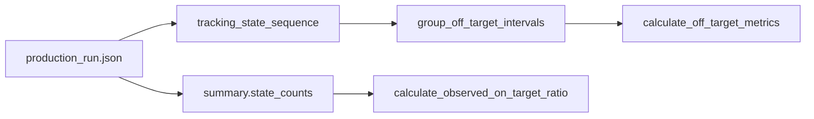

# Day 14 — Production Tracking Metrics 검증과 Phase 3 마무리

- 작업 기간: 2026-10-14~2026-10-16
- 단계: Phase 3 — 기초 Tracking Metrics 완료, 방향별 분석 준비
- 범위: 저장된 Day 12 Production 결과로 OFF_TARGET 구간·Metrics를 검증하고 관측 구간 조준 일치율을 확정·구현

## 작업 목표와 입력

Day 13의 Synthetic Sequence 검증을 실제 60초 Run으로 확장했다. 입력은 `outputs/day12_validation/production_run.json`에 저장된 결과다. 이번 검증에서 원본 영상을 새로 디코딩하거나 Detection 정책을 변경하지 않았다.



`tracking_state_sequence`는 구간 추출의 입력이고, `summary.fps`는 각 구간의 Frame 수를 초로 바꾸는 기준이다. `summary.state_counts`는 관측 구간 조준 일치율의 입력이다. 두 계산 경로 모두 저장된 Phase 2 상태를 읽으며 상태 분류를 수정하지 않는다.

## A. 실제 Production 분석 결과

| 항목 | 확인한 값 |
| --- | ---: |
| FPS | 60.0 |
| Run Frame | 356~3955, 총 3600개 |
| ON_TARGET / OFF_TARGET / MISSING | 2319 / 1000 / 281 |
| OFF_TARGET Interval Count | 94개 |
| Total OFF_TARGET Duration | 16.666666666666664초 (약 16.667초) |
| Average OFF_TARGET Interval Duration | 0.17730496453900707초 |
| End Reason Distribution | ON_TARGET 94 / MISSING 0 / RUN_END 0 |
| Observed On-target Ratio | 2319 / 3319 = 0.698704429044893 |

이번 Run의 모든 OFF_TARGET 구간은 다음 ON_TARGET 관측에서 끝났다. MISSING Frame은 281개 있지만, OFF_TARGET 구간을 직접 종료한 MISSING은 0개다. 이 결과를 다른 영상이나 모든 Target 전환 상황의 성질로 일반화하지 않는다.

## B. 검증 결과

- `sum(interval["off_target_frame_count"] ...)`가 Production의 OFF_TARGET 1000 Frame 및 Run Metrics의 합계와 일치했다.
- 총 Duration을 `1000 / 60`초와 `math.isclose(..., rel_tol=1e-9)`로 비교했다. 표에 적은 소수점 끝자리 차이는 부동소수점 표현 차이다.
- 각 구간의 `end_frame_index_exclusive - start_frame_index`가 저장된 `off_target_frame_count`와 일치하고, 종료 원인은 `ON_TARGET`, `MISSING`, `RUN_END` 중 하나였다.
- 원본 Sequence에서 수집한 OFF_TARGET Frame 번호 목록과 모든 구간의 `[start_frame_index, end_frame_index_exclusive)`가 생성한 Frame 번호 목록이 **번호와 순서까지 동일**했다. 합계만으로는 찾을 수 없는 중복·누락도 이 비교로 확인했다.
- Raw Observation과 Tracking State는 각각 3600개이며 Frame Index와 시간이 서로 대응했다. Phase 2의 상태별 Count `2319 / 1000 / 281`은 유지됐다.
- `tests/test_tracking_metrics.py`: **8 passed**. 기존 구간 Metrics 2개와 관측 일치율의 기본·관측 없음·전체 OFF_TARGET·음수 입력 사례를 포함한다.
- 전체 프로젝트 회귀 테스트: **65 passed** (`python -m pytest -q`). 검증 스크립트도 저장된 Production JSON으로 실행해 통과했다.
- 미해결 실행 오류는 없다. 이 단계의 실제 Run 검증은 저장된 JSON을 재사용했으며 영상 재분석과 새로운 수동 Ground Truth 검증은 수행하지 않았다.

## C. 구현, 계약, 작업 책임

사용자가 `src/inspect_tracking_metrics.py`에서 두 함수 연결, Frame 합계·시간·경계·종료 원인 검사, 원본/구간 Frame 번호 목록 비교를 직접 작성하고 실행했다. `src/tracking_metrics.py`의 `calculate_observed_on_target_ratio()`와 `tests/test_tracking_metrics.py`의 새 테스트도 직접 작성했다. Codex는 함수 계약과 작은 TODO를 제시하고 코드를 리뷰했으며, 독립 실행·전체 회귀 테스트·문서화를 수행했다.

관측 구간 조준 일치율의 확정 계약은 다음과 같다.

```text
ON_TARGET Frame 수 / (ON_TARGET Frame 수 + OFF_TARGET Frame 수)
```

`MISSING`은 조준 상태를 판단할 수 없으므로 분모에서 제외한다. 분모가 0이면 `0.0`이 아니라 `None`을 반환한다. 관측 Frame이 있고 전부 OFF_TARGET이면 `0.0`이다. 두 Frame Count 중 하나라도 음수이면 잘못된 입력으로 보고 `ValueError`를 발생시킨다. 이 값은 관측 가능한 Frame에 대한 조준 일치율이며 게임의 Accuracy나 방향별 Tracking 성능과 동일하다고 주장하지 않는다.

수정·추가된 파일의 책임은 다음과 같다.

| 파일 | 역할 |
| --- | --- |
| `src/inspect_tracking_metrics.py` | 사용자가 작성한 저장 JSON 기반 개발용 Run 검증·출력 경로 |
| `src/tracking_metrics.py` | 사용자가 작성한 관측 구간 조준 일치율 계산·입력 검증 함수 |
| `tests/test_tracking_metrics.py` | 사용자가 작성한 비율 함수의 정상·빈 관측·0.0·음수 입력 테스트 |
| `docs/02_data_and_metric_specification.md` | 확정된 비율·MISSING·None·음수 입력 계약 기록 |
| `aim_tracking_project_build_plan.md` | 도메인 의미·역할·단위를 드러내는 네이밍 규칙 한 줄 추가 |
| `README.md` | 실제 Run 결과, 테스트 수, 직접 구현과 AI 지원 범위 갱신 |

구간은 연속 상태, Duration은 지속 시간, Frame Index는 위치, Frame Count는 개수로 구분했다. 새 분석 변수에는 `observed_off_target_frame_indices`, `interval_off_target_frame_indices`, `observed_on_target_ratio`처럼 역할을 드러내는 이름을 사용했다.

## D. 다음 Phase에 넘기는 데이터와 Deferred

저장된 `raw_observations`의 3600개 기록에는 `frame_index`, `frame_time_seconds`, `center`의 `[x, y]` 좌표, `valid_candidate_count`, `status`가 있다. 같은 Frame Index·시간으로 `tracking_state_sequence`와 대응시킬 수 있다. MISSING 281개는 `center=None`이며, 위치를 결정한 Frame에는 좌표가 있다. 화면상 Target 위치 변화와 Crosshair 기준 상대 위치를 분석할 입력은 확보했다.

다음 Phase에서는 Target Movement Direction과 Crosshair 기준 Relative Target Direction을 별도로 정의해야 한다. 특히 MISSING 전후 좌표가 같은 Target인지 보장되지 않고, Target 교체 순간의 큰 좌표 차이를 이동 방향으로 오해할 수 있다. 정지·저속/노이즈 경계, 방향 전환 조건, 유효 관측 범위도 아직 결정되지 않았다. 영상의 화면상 이동은 실제 마우스 입력을 직접 측정한 값이 아니다.

방향별 Metric, Direction Change Detector, Recovery 분석, Target Identity 추정, MISSING 보간, 새 Detection 알고리즘, Dashboard·API·DB 연동은 이번 Day 14에서 구현하지 않았다.

## 배운 점

- `sum()`은 Dictionary 목록 전체가 아니라 각 Dictionary에서 꺼낸 숫자를 합산한다. `len(intervals)`는 구간 수이고 `off_target_frame_count`는 구간 안의 Frame 수다.
- `dict["end_reason"]`은 키 이름을, `dict[end_reason]`은 변수에 저장된 키 값을 사용한다. `in`으로 실제 종료 원인이 허용된 세 값 중 하나인지 검사한다.
- `print()`는 화면에 보여주고 `return`은 값을 호출한 곳에 전달한다. 비율 `0.75`와 퍼센트 `75%`, 관측 없음 `None`과 관측된 `0.0`을 구분한다.
- 테스트가 실행에 성공했다는 사실만으로 조건이 올바르다고 단정하지 않는다. 잘못된 값에서도 실패하는지 확인해 검증식의 의미를 점검했다.

## 추천 커밋 메시지

```text
feat: verify production tracking metrics and observed on-target ratio 및 Day14 작업일지 정리
```
